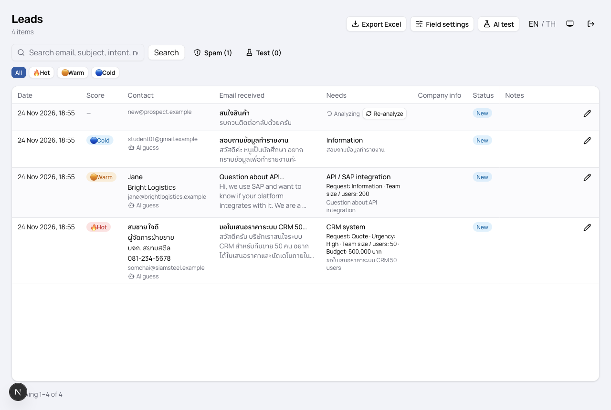

# eve Lead Intake Extension

Read inbound customer emails, score and save each lead (Hot / Warm / Cold), and reply automatically with a contact-form link. Built for [eve](https://eve.dev) agents, with a complete example app.

[](https://github.com/mintelligence-dev/eve-lead-intake-extension/actions/workflows/ci.yml)
[](LICENSE)
[](https://eve.dev)
[](https://nextjs.org)
[](https://www.typescriptlang.org)
[](https://www.npmjs.com/package/@eve-lead-intake-extension/eve)
[](https://www.npmjs.com/package/@eve-lead-intake-extension/core)

**English** · [ภาษาไทย](README.th.md)



<sub>Screenshot data is made up.</sub>

Deploy your own copy of the example app. The button asks for your Resend key, sender address and admin login, and sets up the Postgres database ([step by step](#deploy-the-example-app)):

[](https://vercel.com/new/clone?repository-url=https%3A%2F%2Fgithub.com%2Fmintelligence-dev%2Feve-lead-intake-extension&root-directory=examples%2Flead-intake-agent&project-name=lead-intake-agent&repository-name=lead-intake-agent&env=RESEND_API_KEY%2CRESEND_FROM_ADDRESS%2CADMIN_USERNAME%2CADMIN_PASSWORD&envDescription=RESEND_API_KEY%3A%20Resend%20%3E%20API%20Keys%20%28Full%20access%29.%20RESEND_FROM_ADDRESS%3A%20onboarding%40resend.dev%20until%20your%20domain%20is%20verified.%20ADMIN_USERNAME%20%2F%20ADMIN_PASSWORD%3A%20the%20web%20login%20you%20choose.%20Postgres%20%28Neon%29%20is%20set%20up%20on%20this%20page.%20After%20deploying%2C%20add%20the%20Resend%20webhook%20%28see%20README%29.&envLink=https%3A%2F%2Fgithub.com%2Fmintelligence-dev%2Feve-lead-intake-extension%23set-up-resend&stores=%5B%7B%22type%22%3A%22integration%22%2C%22integrationSlug%22%3A%22neon%22%2C%22productSlug%22%3A%22neon%22%2C%22envVarPrefix%22%3A%22DATABASE%22%2C%22allowConnectExistingProduct%22%3Atrue%7D%5D)

## What is in this repository

| | What it is | How to use it |
|---|---|---|
| [`packages/eve`](packages/eve) | The eve extension: a Resend email channel, the `enrich_sender` and `save_lead` tools, the intake instructions, a daily job, and a `./desk` export for web pages | `npm install @eve-lead-intake-extension/eve`, then mount it ([Quick start](#quick-start-add-it-to-your-agent)) |
| [`packages/core`](packages/core) | The rules on their own, with no framework and no dependencies: lead fields, scores, automated-email detection, signed tokens | `npm install @eve-lead-intake-extension/core` |
| [`examples/lead-intake-agent`](examples/lead-intake-agent) | A complete app built on the extension: leads table, field settings, customer form and AI test page, styled with [Mintel UI](https://mintel-ui.vercel.app) | [Deploy your own copy](#deploy-the-example-app) |

## How it works

```
Customer ── email ──▶ Resend ── webhook (signed) ──▶ /eve/v1/resend
                                                        │
              skip automated mail and duplicates → save to Postgres ("analyzing")
                                                        │
          agent: enrich_sender (company lookup) → save_lead (fields + Hot/Warm/Cold score)
                                                        │
Customer ◀── short reply + contact-form link ── Resend ◀┘
```

1. **Every email is saved before the model runs**, so an AI outage never loses a lead.
2. **The agent reads it like a sales rep**: it looks up the sender's company ([context.dev](https://context.dev), optional), fills structured fields (name, title, company, phone, product, team size, budget, timeline, request, urgency) and scores the lead with a one-line reason.
3. **Spam is kept aside and never answered.** Auto-replies, bounces, mailing lists and no-reply senders never reach the agent.
4. **The customer gets a short acknowledgment** in their own language, in the same thread, with a link to confirm their contact details (with PDPA consent). The agent never quotes prices or makes promises.
5. **Your team works the leads** on a web page: filter by score, search, edit, export to Excel, and re-run stuck analyses.

## Safeguards

| Rule | How it is enforced |
|---|---|
| A model outage never loses a lead | The email is saved first (`recordInboundEmail()`). Failed model calls are retried, then a fallback model is used (`resilientModel()`). Stuck analyses are re-run daily and on demand (`redispatchStuckAnalyses()`). |
| Instructions inside emails are ignored | The intake instructions treat the subject and body as untrusted data and limit the reply to a short acknowledgment. |
| Replies contain only the reply | The final message is emailed as is, so the instructions forbid notes about tools, ids or how the agent worked. |
| The agent doesn't guess | Every field is optional and filled only from what the email says. Details the customer confirmed are never overwritten (`completeAnalysis()`). |
| No replies to spam or bots | Spam is decided per thread (`threadLeadIsSpam()`), automated mail by headers and sender (`isAutomatedEmail()`), and replies are capped at 3 per thread per day. |
| Forged webhooks are rejected | Signatures are checked with `RESEND_WEBHOOK_SECRET`. Duplicate deliveries are dropped. |
| Customer form links can't be forged | Each link is HMAC-signed, bound to one lead, and expires after 14 days. |

## Quick start: add it to your agent

Already have an eve agent? Install the extension:

```bash
npm install @eve-lead-intake-extension/eve
```

Then mount it with one file:

```ts
// agent/extensions/lead.ts
import lead from "@eve-lead-intake-extension/eve";

export default lead({
  databaseUrl: process.env.DATABASE_URL,
  email: { fromAddress: "leads@mail.example.com", replyTo: "inbox@example.com" },
  enrichment: { contextApiKey: process.env.CONTEXT_API_KEY! }, // leave out to skip company lookup
  form: { baseUrl: "https://leads.example.com" },               // leave out to send no form link
  dataLanguage: "English",
});
```

Your agent gets `lead__save_lead`, `lead__enrich_sender`, the `lead__resend` channel (webhook at `/eve/v1/resend`), the re-analyze route and the daily job. The extension only describes lead intake; your agent keeps its own identity and model.

Web pages and other code outside the agent use `openLeadDesk()` from `@eve-lead-intake-extension/eve/desk`, with the same settings, to read and change leads, fields, form links and admin sessions. The example app shares one config module between the mount and the desk: [`lead-intake.config.ts`](examples/lead-intake-agent/lead-intake.config.ts) and [`lead.desk.ts`](examples/lead-intake-agent/lead.desk.ts). Every setting is described in [`packages/eve`](packages/eve#settings).

Needs eve 1.4 or later and Node.js 24.

## Deploy the example app

[](https://vercel.com/new/clone?repository-url=https%3A%2F%2Fgithub.com%2Fmintelligence-dev%2Feve-lead-intake-extension&root-directory=examples%2Flead-intake-agent&project-name=lead-intake-agent&repository-name=lead-intake-agent&env=RESEND_API_KEY%2CRESEND_FROM_ADDRESS%2CADMIN_USERNAME%2CADMIN_PASSWORD&envDescription=RESEND_API_KEY%3A%20Resend%20%3E%20API%20Keys%20%28Full%20access%29.%20RESEND_FROM_ADDRESS%3A%20onboarding%40resend.dev%20until%20your%20domain%20is%20verified.%20ADMIN_USERNAME%20%2F%20ADMIN_PASSWORD%3A%20the%20web%20login%20you%20choose.%20Postgres%20%28Neon%29%20is%20set%20up%20on%20this%20page.%20After%20deploying%2C%20add%20the%20Resend%20webhook%20%28see%20README%29.&envLink=https%3A%2F%2Fgithub.com%2Fmintelligence-dev%2Feve-lead-intake-extension%23set-up-resend&stores=%5B%7B%22type%22%3A%22integration%22%2C%22integrationSlug%22%3A%22neon%22%2C%22productSlug%22%3A%22neon%22%2C%22envVarPrefix%22%3A%22DATABASE%22%2C%22allowConnectExistingProduct%22%3Atrue%7D%5D)

The button installs **your own copy**, with your own database, email and login.

1. Click **Deploy with Vercel** and sign in.
2. Under **Storage**, add **Neon** to create a Postgres database (the free plan works). Pick the **Singapore** region, to match the functions in `vercel.json` (`sin1`).
3. Fill in the four values it asks for (see [Set up Resend](#set-up-resend) for the first two) and deploy:
   - `RESEND_API_KEY`
   - `RESEND_FROM_ADDRESS`
   - `ADMIN_USERNAME` and `ADMIN_PASSWORD`: the login you choose
4. Finish the Resend steps below, add `RESEND_WEBHOOK_SECRET` and `RESEND_REPLY_TO`, then **Redeploy**.
5. Send a test email to your inbound address. You can also try the agent right away on the **AI test** page (`/s`); it sends no email.

No AI key is needed on Vercel: the deployment signs in to the [AI Gateway](https://vercel.com/ai-gateway) by itself. Environment variable changes apply only after a **Redeploy**.

## Set up Resend

[Resend](https://resend.com) receives the customers' emails and sends the replies. You need four values from it:

| Variable | What it is | Where to get it |
|---|---|---|
| `RESEND_API_KEY` | Lets the app send replies and read incoming emails | Resend → **API Keys** → Create. Choose **Full access**: a sending-only key can't read incoming mail. Starts with `re_`. |
| `RESEND_FROM_ADDRESS` | The sender of the replies, e.g. `leads@mail.example.com` | An address on a domain verified in Resend → **Domains**. Until then, use `onboarding@resend.dev`, which only delivers to your own Resend account. |
| `RESEND_REPLY_TO` | Your inbound address: where customers write, and where their replies come back | Resend → **Receiving**. Without it, a customer's reply goes to the sender address and may never arrive. |
| `RESEND_WEBHOOK_SECRET` | Proves that a webhook really came from Resend. Without it, no email is received. | Resend → **Webhooks** → Add webhook: URL `https://<your-domain>/eve/v1/resend`, event **`email.received`**. Copy its signing secret (`whsec_…`). |

Mark the API key and the webhook secret as **Sensitive** in Vercel.

## The example app

| Page | What it is for |
|---|---|
| `/leads` | The leads table, 10 per page: filter by score, search, edit, delete (recoverable), export to Excel. Spam and test leads are kept in their own views. |
| `/settings/fields` | Add, rename, hide and reorder the lead fields without a deploy. Changes reach the next email, the table, the form and the export within about 15 seconds. |
| `/s` | **AI test page**: simulate an email and watch the analysis live. Nothing is emailed, and test leads stay separate. |
| `/f/<token>` | **Public** customer form, linked from the reply email. |
| `/login` | Admin login. |

- **Languages:** every page has a TH / EN switch and follows the browser by default. The lead data the agent writes is Thai unless `LEAD_DATA_LANGUAGE` says otherwise; replies follow the customer.
- **Look and feel:** [Mintel UI](https://mintel-ui.vercel.app) (brand colors in light and dark, Manrope + Rubik + IBM Plex Sans Thai) through the shadcn registry in `examples/lead-intake-agent/components.json`. Add more with `npx shadcn@latest add @mintel/<name>`.
- **Fields:** values live in one JSON column, so adding or removing a field needs no migration. Hiding a field keeps its data. The defaults are in [`packages/core/src/lead-schema.ts`](packages/core/src/lead-schema.ts).

### Environment variables

Every variable is described in [`.env.example`](examples/lead-intake-agent/.env.example). Never commit `.env.local` or real values.

| Variable | Required | What it does |
|---|---|---|
| `DATABASE_URL` | ✓ | Postgres, any provider; the pooled URL on serverless. `POSTGRES_URL` is read when it is missing. |
| `RESEND_API_KEY`, `RESEND_FROM_ADDRESS`, `RESEND_WEBHOOK_SECRET` | ✓ | Email in and out ([Set up Resend](#set-up-resend)) |
| `RESEND_REPLY_TO` | recommended | Your inbound address |
| `ADMIN_USERNAME`, `ADMIN_PASSWORD` | ✓ | Web login |
| `CONTEXT_API_KEY` | | Company lookup by sender ([context.dev](https://context.dev)). Without it the agent works from the email alone. |
| `AI_GATEWAY_API_KEY` | off Vercel only | AI Gateway key for running outside Vercel |
| `AI_MODEL`, `AI_FALLBACK_MODEL` | | `provider/model` ids from the [AI Gateway catalog](https://vercel.com/ai-gateway/models). Defaults: `anthropic/claude-haiku-5.5`, falling back to `google/gemini-3.5-flash-lite`. |
| `GOOGLE_GENERATIVE_AI_API_KEY` | | Call Gemini directly instead of through the Gateway |
| `COMPANY_NAME`, `PRIVACY_POLICY_URL` | | Shown on the customer form |
| `PUBLIC_APP_URL` | | Base of the form links; defaults to the Vercel production domain |
| `LEAD_DATA_LANGUAGE` | | Language of the lead data the agent writes (default `Thai`) |
| `ADMIN_SESSION_SECRET`, `LEAD_FORM_SECRET` | | Signing secrets. Generated and stored in the database when unset; changing them logs everyone out and breaks form links already sent. |
| `SIMULATE_AI_OUTAGE` | | Demos only: `primary` or `all` |

### Costs

- **Model:** one email takes about 3 model calls, roughly 10,000–12,000 input and 600 output tokens, estimated from the instruction sizes. With the default `anthropic/claude-haiku-5.5` that is about **$0.0015 per email** ($0.10 / $0.50 per 1M tokens, AI Gateway prices on 10 Nov 2026). Thai uses more tokens than English. Most Gateway models need paid credits.
- **Services:** Vercel Hobby is fine for trying it out, but commercial use needs Pro, and Hobby runs the daily job at most once a day. Resend, context.dev and Neon have free tiers. No Redis is needed: thread state lives in the same Postgres.

## Develop

Needs **Node.js 24**. Run from the repository root (npm workspaces):

```bash
npm install
cp examples/lead-intake-agent/.env.example examples/lead-intake-agent/.env.local   # fill in real values
npm run dev          # http://localhost:3000, no login in development
```

| Command | |
|---|---|
| `npm run dev` | Run the example app |
| `npm run typecheck` | Type-check core, the extension and the app |
| `npm test` | Tests for `packages/core` |
| `npm run build` | Build core, the extension and the app |

To use the AI locally without a key, link a Vercel project from `examples/lead-intake-agent` with `npx eve link`; it writes an AI Gateway token to `.env.local`.

```
packages/core/src/              rules: fields, scores, automated-email check, prompt format, signed tokens
packages/eve/extension/         the extension (mounted as lead__…)
  extension.ts                  every setting (zod)
  instructions/                 intake workflow, scoring rubric, guardrails, live field list
  tools/                        enrich_sender, save_lead
  channels/                     resend (email in/out), lead-admin (re-analyze)
  schedules/daily-maintenance   09:00 Bangkok: re-run stuck analyses, clear expired thread state
  lib/desk.ts                   openLeadDesk() for web pages
examples/lead-intake-agent/     the example app
  lead-intake.config.ts         one config for the mount and the pages (from env)
  agent/                        identity, model + fallback, extension mount, web channel
  app/                          leads, settings, customer form, AI test page, login
```

## Limits

- **Resend only.** `packages/eve/extension/channels/resend.ts` relies on internals of `@resend/chat-sdk-adapter` 0.3; check it first after upgrading.
- **Email-first.** Mounting the extension always adds the email channel. `save_lead` works from other channels, but replies and form links happen over email only.
- **One admin account**, with no limit on failed login attempts yet.
- **One database per process** for the mount and the desk.
- **Automated tests cover `packages/core` only.** Email and database paths are tested by hand, and there is no alerting yet.

## Contributing

Issues and pull requests are welcome. Run `npm run typecheck`, `npm test` and `npm run build` before opening a pull request, and open an issue first for larger changes. Never commit keys or `.env.local`. See [CONTRIBUTING.md](CONTRIBUTING.md) for the rules, the [Code of Conduct](CODE_OF_CONDUCT.md), and [SECURITY.md](SECURITY.md) to report a vulnerability privately.

## Contributors

- [kongkeat](https://github.com/kongkeat): author of the original Lead Intake Agent
- The M Intelligence team

## License

[MIT](LICENSE) © 2026 M Intelligence
