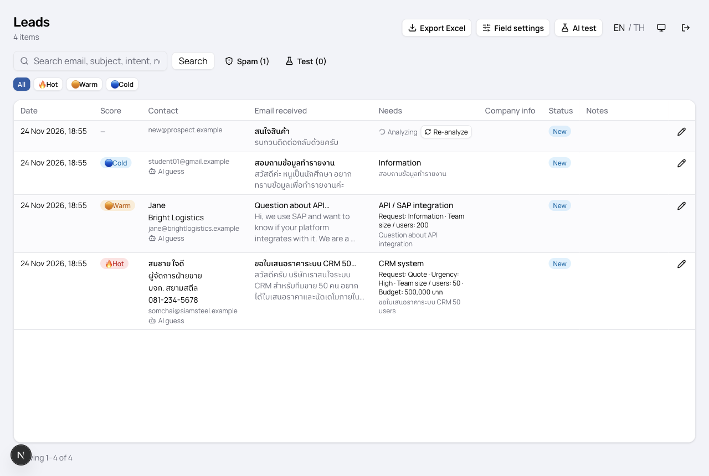

# eve Lead Intake Extension

รับอีเมลจากลูกค้า ให้คะแนนและบันทึกเป็น lead (Hot / Warm / Cold) แล้วตอบกลับอัตโนมัติพร้อมลิงก์ฟอร์มให้ลูกค้ายืนยันข้อมูลติดต่อ ทำเป็น extension สำหรับ agent ที่สร้างด้วย [eve](https://eve.dev) และมีแอปตัวอย่างที่ใช้งานได้ครบ

[](https://github.com/mintelligence-dev/eve-lead-intake-extension/actions/workflows/ci.yml)
[](LICENSE)
[](https://eve.dev)
[](https://nextjs.org)
[](https://www.typescriptlang.org)
[](https://www.npmjs.com/package/@eve-lead-intake-extension/eve)
[](https://www.npmjs.com/package/@eve-lead-intake-extension/core)

[English](README.md) · **ภาษาไทย**



<sub>ข้อมูลในภาพเป็นข้อมูลสมมติ</sub>

deploy แอปตัวอย่างเป็นของคุณเองได้ด้วยปุ่มเดียว ปุ่มจะให้กรอก key ของ Resend อีเมลผู้ส่ง และรหัสเข้าระบบ แล้วตั้งฐานข้อมูล Postgres ให้ ([ทีละขั้น](#ติดตั้งแอปตัวอย่าง))

[](https://vercel.com/new/clone?repository-url=https%3A%2F%2Fgithub.com%2Fmintelligence-dev%2Feve-lead-intake-extension&root-directory=examples%2Flead-intake-agent&project-name=lead-intake-agent&repository-name=lead-intake-agent&env=RESEND_API_KEY%2CRESEND_FROM_ADDRESS%2CADMIN_USERNAME%2CADMIN_PASSWORD&envDescription=RESEND_API_KEY%3A%20Resend%20%3E%20API%20Keys%20%28Full%20access%29.%20RESEND_FROM_ADDRESS%3A%20onboarding%40resend.dev%20until%20your%20domain%20is%20verified.%20ADMIN_USERNAME%20%2F%20ADMIN_PASSWORD%3A%20the%20web%20login%20you%20choose.%20Postgres%20%28Neon%29%20is%20set%20up%20on%20this%20page.%20After%20deploying%2C%20add%20the%20Resend%20webhook%20%28see%20README%29.&envLink=https%3A%2F%2Fgithub.com%2Fmintelligence-dev%2Feve-lead-intake-extension%23set-up-resend&stores=%5B%7B%22type%22%3A%22integration%22%2C%22integrationSlug%22%3A%22neon%22%2C%22productSlug%22%3A%22neon%22%2C%22envVarPrefix%22%3A%22DATABASE%22%2C%22allowConnectExistingProduct%22%3Atrue%7D%5D)

## ใน repo นี้มีอะไร

| | คืออะไร | ใช้ยังไง |
|---|---|---|
| [`packages/eve`](packages/eve) | ตัว eve extension: ช่องทางอีเมล Resend, tool `enrich_sender` และ `save_lead`, คำสั่ง AI สำหรับรับ lead, งานประจำวัน และ `./desk` ให้หน้าเว็บใช้ | `npm install @eve-lead-intake-extension/eve` แล้ว mount ([เริ่มใช้](#เริ่มใช้-ใส่ใน-agent-ของคุณ)) |
| [`packages/core`](packages/core) | กติกาล้วนๆ ไม่ผูก framework ไม่มี dependency: ฟิลด์ lead, คะแนน, ตรวจเมลอัตโนมัติ, token ที่เซ็นกันปลอม | `npm install @eve-lead-intake-extension/core` |
| [`examples/lead-intake-agent`](examples/lead-intake-agent) | แอปเต็มที่ใช้ extension นี้: ตาราง lead, ตั้งค่าฟิลด์, ฟอร์มลูกค้า, หน้าทดสอบ AI หน้าตาใช้ [Mintel UI](https://mintel-ui.vercel.app) | [ติดตั้งของคุณเอง](#ติดตั้งแอปตัวอย่าง) |

## ทำงานยังไง

```
ลูกค้า ── อีเมล ──▶ Resend ── webhook (มีลายเซ็น) ──▶ /eve/v1/resend
                                                        │
              ข้ามเมลอัตโนมัติและเมลซ้ำ → บันทึกลง Postgres ("กำลังวิเคราะห์")
                                                        │
          agent: enrich_sender (หาข้อมูลบริษัท) → save_lead (ข้อมูลแยกช่อง + คะแนน)
                                                        │
ลูกค้า ◀── คำตอบสั้นๆ + ลิงก์ฟอร์ม ── Resend ◀──────────┘
```

1. **บันทึกอีเมลทุกฉบับก่อนเรียก AI** AI ล่มแล้ว lead ก็ไม่หาย
2. **AI อ่านเหมือนพนักงานขาย** หาข้อมูลบริษัทผู้ส่ง ([context.dev](https://context.dev) ไม่บังคับ) กรอกข้อมูลแยกช่อง (ชื่อ ตำแหน่ง บริษัท เบอร์ สินค้า ขนาดทีม งบ ช่วงเวลา สิ่งที่ขอ ความเร่งด่วน) และให้คะแนนพร้อมเหตุผลหนึ่งบรรทัด
3. **สแปมเก็บแยกไว้และไม่ตอบ** ส่วนเมลตอบกลับอัตโนมัติ bounce mailing list และ no-reply ไม่ถึง AI เลย
4. **ลูกค้าได้คำตอบสั้นๆ** ในภาษาของลูกค้า ต่อเธรดเดิม พร้อมลิงก์ยืนยันข้อมูลติดต่อ (มีช่องยินยอม PDPA) AI ไม่ให้ราคาหรือรับปากแทนทีม
5. **ทีมขายดู lead บนหน้าเว็บ** กรองตามคะแนน ค้นหา แก้ไข Export Excel และสั่งวิเคราะห์ใหม่ได้

## หลักความปลอดภัย

| กฎ | บังคับใช้อย่างไร |
|---|---|
| AI ล่มแล้ว lead ไม่หาย | บันทึกอีเมลก่อน (`recordInboundEmail()`) · เรียก model ไม่สำเร็จจะลองซ้ำแล้วสลับ model สำรอง (`resilientModel()`) · รายการค้างถูกส่งให้ AI ใหม่ทุกวันและกดสั่งเองได้ (`redispatchStuckAnalyses()`) |
| ไม่ทำตามคำสั่งในอีเมล | คำสั่ง AI ให้ถือหัวเรื่องและเนื้อหาอีเมลเป็นข้อมูลที่เชื่อไม่ได้ และตอบรับสั้นๆ อย่างเดียว |
| คำตอบมีแค่คำตอบ | ข้อความสุดท้ายถูกส่งเป็นอีเมลตามนั้น คำสั่ง AI จึงห้ามใส่หมายเหตุเรื่อง tool, เลข id หรือวิธีทำงาน |
| AI ไม่เดาข้อมูล | ทุกช่องไม่บังคับ กรอกเฉพาะที่อีเมลบอก · ข้อมูลที่ลูกค้ายืนยันแล้วไม่ถูกเขียนทับ (`completeAnalysis()`) |
| ไม่ตอบสแปมและบอท | ตัดสินสแปมรายเธรด (`threadLeadIsSpam()`) · ตรวจเมลอัตโนมัติจาก header และผู้ส่ง (`isAutomatedEmail()`) · ตอบไม่เกิน 3 ครั้งต่อเธรดต่อวัน |
| webhook ปลอมไม่ได้ | ตรวจลายเซ็นด้วย `RESEND_WEBHOOK_SECRET` และทิ้งเมลที่ส่งซ้ำ |
| ลิงก์ฟอร์มลูกค้าปลอมไม่ได้ | แต่ละลิงก์เซ็น HMAC ผูกกับ lead เดียว และหมดอายุใน 14 วัน |

## เริ่มใช้: ใส่ใน agent ของคุณ

มี eve agent อยู่แล้ว ติดตั้ง extension:

```bash
npm install @eve-lead-intake-extension/eve
```

แล้ว mount ด้วยไฟล์เดียว:

```ts
// agent/extensions/lead.ts
import lead from "@eve-lead-intake-extension/eve";

export default lead({
  databaseUrl: process.env.DATABASE_URL,
  email: { fromAddress: "leads@mail.example.com", replyTo: "inbox@example.com" },
  enrichment: { contextApiKey: process.env.CONTEXT_API_KEY! }, // ไม่ใส่ = ข้ามการหาข้อมูลบริษัท
  form: { baseUrl: "https://leads.example.com" },               // ไม่ใส่ = ไม่แนบลิงก์ฟอร์ม
  dataLanguage: "Thai",
});
```

agent จะได้ `lead__save_lead`, `lead__enrich_sender`, ช่องทาง `lead__resend` (webhook ที่ `/eve/v1/resend`), route "วิเคราะห์ใหม่" และงานประจำวัน คำสั่ง AI ของ extension บอกแค่เรื่องรับ lead ตัวตนและ model ของ agent ยังเป็นของคุณ

หน้าเว็บหรือโค้ดที่ไม่ได้รันใน agent ใช้ `openLeadDesk()` จาก `@eve-lead-intake-extension/eve/desk` ด้วยค่าเดียวกัน เพื่ออ่านและแก้ lead, ฟิลด์, ลิงก์ฟอร์ม และ session ผู้ดูแล แอปตัวอย่างใช้ config ไฟล์เดียวร่วมกันทั้ง mount และ desk: [`lead-intake.config.ts`](examples/lead-intake-agent/lead-intake.config.ts) และ [`lead.desk.ts`](examples/lead-intake-agent/lead.desk.ts) ดูค่าที่ตั้งได้ทั้งหมดใน [`packages/eve`](packages/eve#settings)

ต้องใช้ eve 1.4 ขึ้นไป และ Node.js 24

## ติดตั้งแอปตัวอย่าง

[](https://vercel.com/new/clone?repository-url=https%3A%2F%2Fgithub.com%2Fmintelligence-dev%2Feve-lead-intake-extension&root-directory=examples%2Flead-intake-agent&project-name=lead-intake-agent&repository-name=lead-intake-agent&env=RESEND_API_KEY%2CRESEND_FROM_ADDRESS%2CADMIN_USERNAME%2CADMIN_PASSWORD&envDescription=RESEND_API_KEY%3A%20Resend%20%3E%20API%20Keys%20%28Full%20access%29.%20RESEND_FROM_ADDRESS%3A%20onboarding%40resend.dev%20until%20your%20domain%20is%20verified.%20ADMIN_USERNAME%20%2F%20ADMIN_PASSWORD%3A%20the%20web%20login%20you%20choose.%20Postgres%20%28Neon%29%20is%20set%20up%20on%20this%20page.%20After%20deploying%2C%20add%20the%20Resend%20webhook%20%28see%20README%29.&envLink=https%3A%2F%2Fgithub.com%2Fmintelligence-dev%2Feve-lead-intake-extension%23set-up-resend&stores=%5B%7B%22type%22%3A%22integration%22%2C%22integrationSlug%22%3A%22neon%22%2C%22productSlug%22%3A%22neon%22%2C%22envVarPrefix%22%3A%22DATABASE%22%2C%22allowConnectExistingProduct%22%3Atrue%7D%5D)

ปุ่มนี้ติดตั้ง**ระบบแยกของคุณเอง** ใช้ฐานข้อมูล อีเมล และรหัส login ของคุณ

1. กด **Deploy with Vercel** แล้ว login
2. ในส่วน **Storage** เพิ่ม **Neon** เพื่อสร้างฐานข้อมูล Postgres (แพ็กเกจฟรีใช้ได้) เลือก region **Singapore** ให้ตรงกับเซิร์ฟเวอร์ใน `vercel.json` (`sin1`)
3. กรอก 4 ค่าที่ถาม แล้วกด Deploy (สองค่าแรกดูที่[ตั้งค่า Resend](#ตั้งค่า-resend)):
   - `RESEND_API_KEY`
   - `RESEND_FROM_ADDRESS`
   - `ADMIN_USERNAME` และ `ADMIN_PASSWORD`: รหัส login ที่ตั้งเอง
4. ทำขั้นตอน Resend ด้านล่างให้ครบ ใส่ `RESEND_WEBHOOK_SECRET` และ `RESEND_REPLY_TO` แล้วกด **Redeploy**
5. ส่งอีเมลทดสอบไปที่ที่อยู่รับเมล หรือลอง AI ได้ทันทีที่หน้า**ทดสอบ AI** (`/s`) ซึ่งไม่ส่งอีเมลจริง

บน Vercel ไม่ต้องใช้ key ของ AI เพราะ deployment ยืนยันตัวตนกับ [AI Gateway](https://vercel.com/ai-gateway) ได้เอง แก้ environment variable แล้วต้อง **Redeploy** ค่าใหม่ถึงจะมีผล

## ตั้งค่า Resend

[Resend](https://resend.com) ทำหน้าที่รับอีเมลจากลูกค้าและส่งคำตอบออกไป ต้องเอาค่ามาใส่ 4 ตัว:

| ตัวแปร | คืออะไร | เอามาจากไหน |
|---|---|---|
| `RESEND_API_KEY` | กุญแจให้ระบบส่งคำตอบและอ่านอีเมลขาเข้า | Resend → **API Keys** → Create ต้องเลือก **Full access** (แบบส่งอย่างเดียวอ่านเมลขาเข้าไม่ได้) ขึ้นต้นด้วย `re_` |
| `RESEND_FROM_ADDRESS` | ที่อยู่ผู้ส่งคำตอบ เช่น `leads@mail.example.com` | ที่อยู่บนโดเมนที่ยืนยันแล้วใน Resend → **Domains** ระหว่างที่ยังไม่ยืนยัน ใช้ `onboarding@resend.dev` ได้ แต่ส่งถึงได้เฉพาะบัญชี Resend ของคุณ |
| `RESEND_REPLY_TO` | ที่อยู่รับเมล: ที่ที่ลูกค้าส่งเมลมา และที่ที่เมลกลับมาเวลาลูกค้ากดตอบ | Resend → **Receiving** ถ้าไม่ตั้ง เวลาลูกค้ากดตอบ เมลจะไปที่ที่อยู่ผู้ส่งและอาจไม่มีใครได้รับ |
| `RESEND_WEBHOOK_SECRET` | รหัสยืนยันว่าข้อมูลที่ส่งเข้ามามาจาก Resend จริง ถ้าไม่ตั้ง ระบบจะไม่รับอีเมลเลย | Resend → **Webhooks** → Add webhook ใส่ URL `https://<โดเมนของคุณ>/eve/v1/resend` เลือก event **`email.received`** แล้วคัดลอก signing secret (`whsec_…`) |

ใน Vercel ให้ติ๊ก **Sensitive** ที่ API key และ webhook secret

## แอปตัวอย่าง

| หน้า | ใช้ทำอะไร |
|---|---|
| `/leads` | ตาราง lead หน้าละ 10 รายการ กรองตามคะแนน ค้นหา แก้ไข ลบ (กู้คืนได้) Export Excel และแยกดูสแปมกับ lead ทดสอบ |
| `/settings/fields` | เพิ่ม แก้ชื่อ ซ่อน และเรียงฟิลด์ข้อมูลได้โดยไม่ต้อง deploy มีผลกับอีเมลถัดไป ตาราง ฟอร์ม และ Excel ภายในประมาณ 15 วินาที |
| `/s` | **หน้าทดสอบ AI** จำลองอีเมลแล้วดู AI วิเคราะห์แบบสด ไม่ส่งอีเมลจริง และแยก lead ทดสอบออกจากของจริง |
| `/f/<token>` | **หน้าสาธารณะ** ฟอร์มให้ลูกค้ายืนยันข้อมูลติดต่อ (ลิงก์อยู่ในเมลตอบ) |
| `/login` | เข้าสู่ระบบผู้ดูแล |

- **ภาษา:** ทุกหน้ามีปุ่ม TH / EN และใช้ภาษาของเบราว์เซอร์เป็นค่าเริ่มต้น ข้อมูลที่ AI เขียนเป็นภาษาไทย เปลี่ยนได้ด้วย `LEAD_DATA_LANGUAGE` ส่วนคำตอบใช้ภาษาของลูกค้าเสมอ
- **หน้าตา:** [Mintel UI](https://mintel-ui.vercel.app) (สีแบรนด์ทั้งโหมดสว่างและมืด, ฟอนต์ Manrope + Rubik + IBM Plex Sans Thai) ผ่าน shadcn registry ใน `examples/lead-intake-agent/components.json` เพิ่ม component ได้ด้วย `npx shadcn@latest add @mintel/<ชื่อ>`
- **ฟิลด์:** ค่าทั้งหมดเก็บในคอลัมน์ JSON เดียว เพิ่มหรือลบฟิลด์ได้โดยไม่ต้องแก้ตาราง ซ่อนฟิลด์แล้วข้อมูลยังอยู่ ค่าเริ่มต้นอยู่ใน [`packages/core/src/lead-schema.ts`](packages/core/src/lead-schema.ts)

### Environment variables

ดูคำอธิบายครบใน [`.env.example`](examples/lead-intake-agent/.env.example) ห้าม commit `.env.local` หรือค่าจริงลง repo

| ตัวแปร | จำเป็น | ใช้ทำอะไร |
|---|---|---|
| `DATABASE_URL` | ✓ | Postgres เจ้าไหนก็ได้ บน serverless ใช้ URL แบบ pooled ถ้าไม่มี ระบบอ่าน `POSTGRES_URL` แทน |
| `RESEND_API_KEY`, `RESEND_FROM_ADDRESS`, `RESEND_WEBHOOK_SECRET` | ✓ | รับ-ส่งอีเมล ([ตั้งค่า Resend](#ตั้งค่า-resend)) |
| `RESEND_REPLY_TO` | แนะนำ | ที่อยู่รับเมล |
| `ADMIN_USERNAME`, `ADMIN_PASSWORD` | ✓ | login หน้าเว็บ |
| `CONTEXT_API_KEY` | | หาข้อมูลบริษัทผู้ส่ง ([context.dev](https://context.dev)) ถ้าไม่ใส่ AI ใช้ข้อมูลจากอีเมลอย่างเดียว |
| `AI_GATEWAY_API_KEY` | เฉพาะนอก Vercel | key ของ AI Gateway ตอนรันนอก Vercel |
| `AI_MODEL`, `AI_FALLBACK_MODEL` | | ชื่อ `provider/model` จาก [AI Gateway catalog](https://vercel.com/ai-gateway/models) ค่าเริ่มต้น `anthropic/claude-haiku-5.5` สำรองด้วย `google/gemini-3.5-flash-lite` |
| `GOOGLE_GENERATIVE_AI_API_KEY` | | เรียก Gemini ตรงแทน AI Gateway |
| `COMPANY_NAME`, `PRIVACY_POLICY_URL` | | แสดงในฟอร์มลูกค้า |
| `PUBLIC_APP_URL` | | URL ต้นทางของลิงก์ฟอร์ม ค่าเริ่มต้นคือโดเมน production ของ Vercel |
| `LEAD_DATA_LANGUAGE` | | ภาษาของข้อมูลที่ AI เขียน (ค่าเริ่มต้น `Thai`) |
| `ADMIN_SESSION_SECRET`, `LEAD_FORM_SECRET` | | secret สำหรับเซ็น ถ้าไม่ตั้ง ระบบสุ่มให้และเก็บในฐานข้อมูล ถ้าเปลี่ยนค่า ทุกคนถูก logout และลิงก์ฟอร์มที่ส่งไปแล้วใช้ไม่ได้ |
| `SIMULATE_AI_OUTAGE` | | ใช้สาธิตเท่านั้น: `primary` หรือ `all` |

### ค่าใช้จ่าย

- **AI model:** อีเมล 1 ฉบับเรียก model ประมาณ 3 ครั้ง รวมราว 10,000–12,000 input token และ 600 output token (ประเมินจากขนาดคำสั่ง) ใช้ `anthropic/claude-haiku-5.5` ที่เป็นค่าเริ่มต้น ตกประมาณ **$0.0015 ต่ออีเมล** ($0.10 / $0.50 ต่อ 1M token ราคา AI Gateway เมื่อ 10 พ.ย. 2569) ภาษาไทยใช้ token มากกว่าภาษาอังกฤษ model ส่วนใหญ่ใน Gateway ต้องเติม credits ก่อน
- **บริการอื่น:** Vercel แพ็กเกจ Hobby ใช้ทดลองได้ แต่ใช้เชิงพาณิชย์ต้องเป็น Pro และ Hobby รันงานประจำวันได้วันละครั้ง Resend, context.dev และ Neon มีแพ็กเกจฟรี ไม่ต้องใช้ Redis เพราะสถานะเธรดเก็บใน Postgres ตัวเดียวกัน

## พัฒนาต่อ

ต้องใช้ **Node.js 24** รันคำสั่งที่โฟลเดอร์บนสุดของ repo (npm workspaces):

```bash
npm install
cp examples/lead-intake-agent/.env.example examples/lead-intake-agent/.env.local   # กรอกค่าจริง
npm run dev          # http://localhost:3000 โหมด dev ไม่ถาม login
```

| คำสั่ง | |
|---|---|
| `npm run dev` | เปิดแอปตัวอย่าง |
| `npm run typecheck` | ตรวจ type ของ core, extension และแอป |
| `npm test` | เทสต์ของ `packages/core` |
| `npm run build` | build core, extension และแอป |

ถ้าจะใช้ AI ในเครื่องโดยไม่มี key ให้ลิงก์ Vercel project จากโฟลเดอร์ `examples/lead-intake-agent` ด้วย `npx eve link` ระบบจะเขียน token ของ AI Gateway ลง `.env.local` ให้

```
packages/core/src/              กติกา: ฟิลด์ คะแนน ตรวจเมลอัตโนมัติ รูปแบบข้อความ token ที่เซ็น
packages/eve/extension/         ตัว extension (mount แล้วได้ชื่อ lead__…)
  extension.ts                  ค่าที่ตั้งได้ทั้งหมด (zod)
  instructions/                 ขั้นตอนรับ lead เกณฑ์คะแนน กติกา และรายการฟิลด์ล่าสุด
  tools/                        enrich_sender, save_lead
  channels/                     resend (รับ-ส่งอีเมล), lead-admin (วิเคราะห์ใหม่)
  schedules/daily-maintenance   09:00 เวลาไทย: วิเคราะห์รายการค้าง ลบสถานะเธรดที่หมดอายุ
  lib/desk.ts                   openLeadDesk() สำหรับหน้าเว็บ
examples/lead-intake-agent/     แอปตัวอย่าง
  lead-intake.config.ts         config ชุดเดียวใช้ทั้ง mount และหน้าเว็บ (อ่านจาก env)
  agent/                        ตัวตน, model + model สำรอง, mount extension, ช่องทางเว็บ
  app/                          หน้า leads ตั้งค่า ฟอร์มลูกค้า ทดสอบ AI และ login
```

## ข้อจำกัด

- **รองรับ Resend เจ้าเดียว** `packages/eve/extension/channels/resend.ts` ใช้ฟังก์ชันภายในของ `@resend/chat-sdk-adapter` 0.3 อัปเกรดไลบรารีแล้วให้ตรวจไฟล์นี้ก่อน
- **ตั้งต้นจากอีเมล** mount แล้วได้ช่องทางอีเมลเสมอ `save_lead` ใช้จากช่องทางอื่นได้ แต่คำตอบและลิงก์ฟอร์มส่งทางอีเมลเท่านั้น
- **บัญชีผู้ดูแลเดียว** และยังไม่จำกัดจำนวนครั้งที่กรอกรหัสผิด
- **ฐานข้อมูลเดียวต่อ process** สำหรับ mount และ desk
- **เทสต์อัตโนมัติมีเฉพาะ `packages/core`** ส่วนอีเมลและฐานข้อมูลทดสอบด้วยมือ และยังไม่มีแจ้งเตือนเมื่อระบบมีปัญหา

## ร่วมพัฒนา

ยินดีรับ issue และ pull request ก่อนส่ง PR ให้รัน `npm run typecheck`, `npm test` และ `npm run build` ให้ผ่าน ถ้าเป็นการเปลี่ยนแปลงใหญ่ให้เปิด issue คุยกันก่อน ห้าม commit key หรือ `.env.local` ดูกฎทั้งหมดใน [CONTRIBUTING.md](CONTRIBUTING.md) และ [CODE_OF_CONDUCT.md](CODE_OF_CONDUCT.md) · แจ้งช่องโหว่แบบส่วนตัวตาม [SECURITY.md](SECURITY.md)

## ผู้พัฒนา

- [kongkeat](https://github.com/kongkeat): ผู้เขียน Lead Intake Agent เวอร์ชันแรก
- ทีม M Intelligence

## สัญญาอนุญาต

[MIT](LICENSE) © 2026 M Intelligence นำไปใช้ แก้ไข และใช้เชิงพาณิชย์ได้ โดยคงข้อความลิขสิทธิ์และสัญญาอนุญาตไว้
